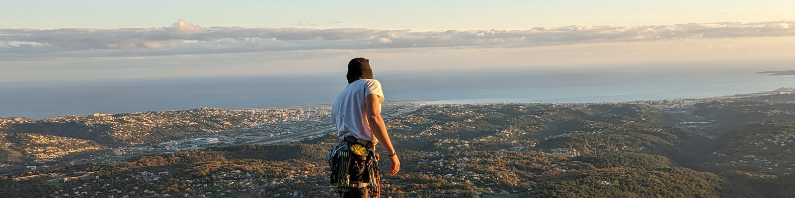

## Pierre Bastiani

Full-stack and DevOps freelancer on the Côte d'Azur. I take over existing codebases, whatever the language, and keep them running. At LivePepper I build the online ordering platform restaurants use, from the Rails back end to the servers it runs on, and I work directly with the restaurant owners who ask for the features. Before that I was a DevOps consultant at Amadeus, moving a legacy C++ service to Azure.

Outside work I self-host and take apart whatever I can. I decoded my air conditioner's infrared protocol ([gree-smartir](https://github.com/PierreBastiani/gree-smartir)), run the house on Home Assistant, and built a supermarket price tracker with Node scrapers and a Rust pipeline. I climb when I'm away from the keyboard.

Ruby on Rails, C++, Python, Node, Rust, Vue · Docker, Kubernetes, OpenShift, ArgoCD, HAProxy · Claude Code agents, local LLMs, YOLO · Home Assistant, Node-RED, ESPHome

